# The effects gallery: every picture package, before and after

Every card below is the **same reference plate**, drawn through a
package's own shader at that package's defaults, by the same
compositor a clip's frames go through - not a mock-up and not a
screenshot of another app. The cards that ship were drawn on a real
GPU and bundled out of a run of the app itself
(`scripts/bundle-cards.sh`); this page is generated from the
packages and those cards by `scripts/effect-gallery.py`, and is
committed so it can be read without building anything.

**The plate - the before, and what every card below was drawn
from:**

## Filters (57)

The colour and look grades, over the whole picture.

<table>
  <tr><td align="center" width="33%">
<b>Adjust</b> Adjust - The manual colour panel every picture clip carries: exposure, tone, balance, sharpness and edge. 
</td><td align="center" width="33%">
<b>High-Contrast Mono</b> Black & White - Black and white pushed hard: deep blacks, bright whites, nothing in between. 
</td><td align="center" width="33%">
<b>Silver</b> Black & White - A cool, soft black and white with the shadows lifted, like a silver print. 
</td></tr>
  <tr><td align="center" width="33%">
<b>Teal & Orange</b> Cinematic - Teal in the shadows, orange in the highlights, skin held as skin, a film curve over it. The blockbuster grade, and the most requested look there is. 
</td><td align="center" width="33%">
<b>Moody</b> Cinematic - Blacks crushed by a film toe, colour drained, bronze through the middle, cool in the shadows, the corners closing in. 
</td><td align="center" width="33%">
<b>Cool Blue</b> Cinematic - Blue in the shadows and midtones, highlights and skin left neutral, contrast up. Cities at dusk. 
</td></tr>
  <tr><td align="center" width="33%">
<b>Night</b> Cinematic - Low light opened up: shadows lifted with the noise softened before it rises, whites held, the blue of the night kept. 
</td><td align="center" width="33%">
<b>Film</b> Cinematic - A film curve with a real toe and shoulder, warm halation around the lights, and grain that moves. Print stock, not a filter. 
</td><td align="center" width="33%">
<b>Daydream</b> Cinematic - Soft cinema: blacks lifted, the light blooming warm, shadows a touch cool, skin kept. The look of a story told in a window seat. 
</td></tr>
  <tr><td align="center" width="33%">
<b>Sage</b> Cinematic - Muted and green-teal through the midtones, a gentle film curve, warmth only where a face is. The quiet grade of an indie film. 
</td><td align="center" width="33%">
<b>Midnight</b> Cinematic - Deep blacks, a cool cast over everything but the lamps, colour low, a little grain. Late-night desk and monologue footage. 
</td><td align="center" width="33%">
<b>Rain</b> Cinematic - Cool, hazy and drained, with the wet reflections lifted and blooming. Street-level walks at the end of the day. 
</td></tr>
  <tr><td align="center" width="33%">
<b>Noir</b> Cinematic - Desaturated and heavy, with a cold cast into the shadows and the corners dimmed. 
</td><td align="center" width="33%">
<b>Bleach Bypass</b> Cinematic - The silver-retention film process: colour washed out, contrast pushed hard. 
</td><td align="center" width="33%">
<b>Cyberpunk</b> Cinematic - Magenta into the shadows, cyan into the light, pushed hard and neon-bright. 
</td></tr>
  <tr><td align="center" width="33%">
<b>Sci-Fi</b> Cinematic - A cool, sterile steel-and-teal grade, saturation held back. 
</td><td align="center" width="33%">
<b>Warm</b> Color - Shifts the picture towards candlelight. 
</td><td align="center" width="33%">
<b>Cool</b> Color - Shifts the picture towards daylight shade. 
</td></tr>
  <tr><td align="center" width="33%">
<b>Vibrance</b> Color - Richer colour where it is muted, without blowing out what is already strong. 
</td><td align="center" width="33%">
<b>Contrast Pop</b> Color - Deeper shadows, brighter highlights. 
</td><td align="center" width="33%">
<b>Fresh</b> Everyday - Daylight footage made to pop: midtones lifted, colour brought up where it is muted, a breath of mint in the brightest whites, skin left alone. 
</td></tr>
  <tr><td align="center" width="33%">
<b>Vivid</b> Everyday - Colour that sings and contrast that bites, with a little edge: the look that reads as a better camera. Skin is held back from the boost. 
</td><td align="center" width="33%">
<b>Clean</b> Everyday - Barely there: neutral, a gentle curve, a touch more colour, and the reds calmed so a face reads even. What a talking head wants. 
</td><td align="center" width="33%">
<b>Soft Light</b> Everyday - A matte: blacks lifted, whites eased down, contrast low, and a soft bloom in the light with cream in it. Airy and flattering. 
</td></tr>
  <tr><td align="center" width="33%">
<b>Golden Hour</b> Everyday - Late light: a warm balance that keeps its brightness, orange in the highlights, a whisper of magenta in the shadows, blacks lifted a touch. 
</td><td align="center" width="33%">
<b>Cloudless Sky</b> Everyday - Skies deeper and bluer, foliage cooler and calmer, the rest of the picture and every face untouched. Travel footage. 
</td><td align="center" width="33%">
<b>Lagoon</b> Everyday - Water and sky turned aquamarine and brightened, sand and skin left warm and clean. The beach-day look creators reach for first. 
</td></tr>
  <tr><td align="center" width="33%">
<b>Milk</b> Everyday - Bright and matte: whites soft and cool, blacks lifted well off the floor, colour quiet. The clean minimal look of a white room. 
</td><td align="center" width="33%">
<b>Ivory</b> Everyday - Milk's warm twin: the same soft matte with cream in the whites and a little gold in the middle. Interiors and morning light. 
</td><td align="center" width="33%">
<b>Umber</b> Everyday - The café look: warm brown through the middle, greens muted to olive, contrast eased. Cosy, and kind to wood and skin alike. 
</td></tr>
  <tr><td align="center" width="33%">
<b>Classic Chrome</b> Film - Muted highlights and deep, open shadows: the restrained look of a classic colour negative. 
</td><td align="center" width="33%">
<b>Super 8</b> Film - Faded, warm and grainy: an old home movie run through a projector. 
</td><td align="center" width="33%">
<b>Retro 70s</b> Film - A heavy warm fade with a yellowed, sun-bleached cast. 
</td></tr>
  <tr><td align="center" width="33%">
<b>Delicious</b> Food - Warm and saturated, the appetising push every food shot wants. 
</td><td align="center" width="33%">
<b>Peach</b> Portrait - Skin warmed toward peach and softened, shadows lifted so lines ease, contrast low. Portraits and talking heads; it is meant to run at half strength. 
</td><td align="center" width="33%">
<b>Fair</b> Portrait - Faces brightened and evened: skin lifted, reds calmed, the balance neutral, the rest of the frame left where it was. 
</td></tr>
  <tr><td align="center" width="33%">
<b>Natural</b> Portrait - A gentle, true-to-life lift: barely-there warmth, skin left alone. 
</td><td align="center" width="33%">
<b>Rosy</b> Portrait - A soft pink lift into the highlights, flattering and warm. 
</td><td align="center" width="33%">
<b>Vintage</b> Retro - A seventies print: matte blacks and whites, colour faded, greens gone to yellow, a soft vignette. 
</td></tr>
  <tr><td align="center" width="33%">
<b>Polaroid</b> Retro - The instant print: a cream matte, warm highlights, cyan creeping into the shadows, a little softness in the corners. 
</td><td align="center" width="33%">
<b>Bronze</b> Retro - Sepia that keeps its contrast and its highlights, so it reads as old film rather than a brown wash. 
</td><td align="center" width="33%">
<b>Mono</b> Retro - Black and white through a coloured filter: red darkens skies and lightens skin, green does the reverse. A little grain if you want it. 
</td></tr>
  <tr><td align="center" width="33%">
<b>VHS</b> Retro - Colour bleeding sideways, scan lines, softness, tape noise and too much saturation, with the slight vertical smear of a worn head. 
</td><td align="center" width="33%">
<b>Digicam</b> Retro - The 2000s point-and-shoot: hard flash, whites blown, colour up, a cool cyan cast, over-sharpened with the sensor's noise. 
</td><td align="center" width="33%">
<b>Falling Dust</b> Retro - A warm fade with dust drifting down through it and a light leak in one corner. The CPU shows the fade and a whisper of noise. 
</td></tr>
  <tr><td align="center" width="33%">
<b>Vivid Landscape</b> Scenery - Greens and blues pushed richer, the punch a travel shot wants. 
</td><td align="center" width="33%">
<b>Autumn</b> Scenery - Greens pulled toward amber, the picture dipped in fall light. 
</td><td align="center" width="33%">
<b>Winter Cool</b> Scenery - Desaturated and blue, the blacks lifted to a matte wintry haze. 
</td></tr>
  <tr><td align="center" width="33%">
<b>Tropical</b> Scenery - Saturated and bright, the water pushed teal. 
</td><td align="center" width="33%">
<b>Pink Fuzz</b> Stylised - Low contrast, pink and lavender in the light, and a soft bloom over it all. The dreamy one. 
</td><td align="center" width="33%">
<b>Neon</b> Stylised - Magenta in the shadows, cyan in the highlights, hard contrast, colour turned up, and the lights themselves blooming. Night streets and signage. 
</td></tr>
  <tr><td align="center" width="33%">
<b>Marquee</b> Stylised - Night city: the lights and signs made vivid and blooming, blacks kept deep and cool, faces left clean. Made for the strip. 
</td><td align="center" width="33%">
<b>Matcha</b> Stylised - Soft green through the midtones and whites, colour muted, a light matte. The trend look, gentle enough for a face. 
</td><td align="center" width="33%">
<b>Spooky</b> Stylised - Drained colour, a green-cyan cast, a hard toe, and a heavy vignette. For the season. 
</td></tr>
  <tr><td align="center" width="33%">
<b>Retro Cartoon</b> Stylised - Flat bands of colour with inked edges, like a printed comic. <a href="../src/crates/concat/cards/concat.retro-cartoon.jpg">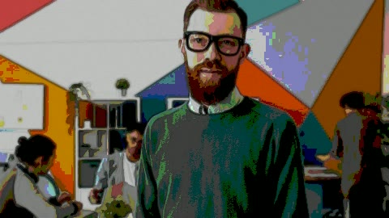</a>
</td><td align="center" width="33%">
<b>Dreamy</b> Vibe - A soft, hazy bloom over lifted pastel blacks. 
</td><td align="center" width="33%">
<b>Vaporwave</b> Vibe - Magenta and cyan pushed hard, a saturated retro-synth cast. 
</td></tr>
</table>

## Effects (123)

The stickers, glows, glitches and frames, over the whole picture.

<table>
  <tr><td align="center" width="33%">
<b>Sharpen</b> Basic - Crisper edges. 
</td><td align="center" width="33%">
<b>Gaussian Blur</b> Blur - A soft, even blur. 
</td><td align="center" width="33%">
<b>Motion Blur</b> Blur - A streak along a line, as if the camera panned. <a href="../src/crates/concat/cards/concat.motion-blur.jpg">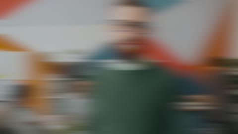</a>
</td></tr>
  <tr><td align="center" width="33%">
<b>Zoom Blur</b> Blur - A rush towards a point, as if the lens zoomed during the shot. 
</td><td align="center" width="33%">
<b>Exposure</b> Color - Brighter or darker by stops of light, as the lens would make it, highlights kept. 
</td><td align="center" width="33%">
<b>Contrast</b> Color - More or less contrast in stops about middle grey, highlights past white kept and black never crushed. 
</td></tr>
  <tr><td align="center" width="33%">
<b>Saturation</b> Color - Richer or greyer colour, about each pixel's own brightness. 
</td><td align="center" width="33%">
<b>White Balance</b> Color - The picture as if lit warmer or cooler, and turned towards magenta or green, as the eye adapts to the light. 
</td><td align="center" width="33%">
<b>Color Wheels</b> Color - Lift, gamma and gain: the shadows, midtones and highlights each pushed towards a hue and made brighter or darker. 
</td></tr>
  <tr><td align="center" width="33%">
<b>Curves</b> Color - The picture's levels bent along curves you draw: luma for brightness alone, then red, green and blue. 
</td><td align="center" width="33%">
<b>Chromatic Pulse</b> Color Play - The channels breathe against each other, red against blue. 
</td><td align="center" width="33%">
<b>Hue Drift</b> Color Play - The hue turns slowly through the shot, one full palette per bar. 
</td></tr>
  <tr><td align="center" width="33%">
<b>Color Cycle</b> Color Play - The palette sweeps across the frame left to right, the music-video wash. 
</td><td align="center" width="33%">
<b>Channel Swap Beat</b> Color Play - The channels trade places on a slow beat - a strange, synthetic wash. 
</td><td align="center" width="33%">
<b>Duotone</b> Color Play - Luma mapped onto two colours of your palette - the title-card read. 
</td></tr>
  <tr><td align="center" width="33%">
<b>Infrared</b> Color Play - False-colour infrared: hot things white, veins dark. 
</td><td align="center" width="33%">
<b>Night Vision</b> Color Play - Green monotone with the gain up - the goggles' view. 
</td><td align="center" width="33%">
<b>Thermal</b> Color Play - The heat palette: blue cold, red hot, the edges of the frame deciding. 
</td></tr>
  <tr><td align="center" width="33%">
<b>X-Ray</b> Color Play - Inverted and blue-white - the radiograph read. 
</td><td align="center" width="33%">
<b>Techno Rush</b> Color Play - A fast hue sweep across the frame, the techno edit's colour energy. 
</td><td align="center" width="33%">
<b>Bleach Bypass</b> Color Play - Skip-bleach: contrast up, saturation nearly gone, hard and filmic. 
</td></tr>
  <tr><td align="center" width="33%">
<b>Posterize Beat</b> Color Play - Posterised colour stepping down a level on a slow beat. 
</td><td align="center" width="33%">
<b>Chroma Key</b> Cutout - Keys out the screen colour you pick, leaving the picture over whatever is beneath, its spill cleaned off. 
</td><td align="center" width="33%">
<b>Luma Key</b> Cutout - Keys out the dark of the picture - fire, smoke or sparks shot on black - or, inverted, the light. 
</td></tr>
  <tr><td align="center" width="33%">
<b>Pixelate</b> Distort - Big square pixels. <a href="../src/crates/concat/cards/concat.pixelate.jpg">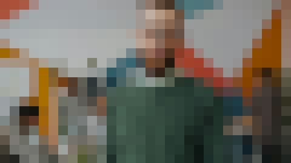</a>
</td><td align="center" width="33%">
<b>Fisheye</b> Distort - The bulge of a very wide lens. 
</td><td align="center" width="33%">
<b>Chromatic Aberration</b> Distort - Red and blue pulled apart towards the edges, the colour fringing of a cheap lens. 
</td></tr>
  <tr><td align="center" width="33%">
<b>Heat Shimmer</b> Distort - The air above a hot road, wobbing sideways. 
</td><td align="center" width="33%">
<b>Water Waves</b> Distort - Slow broad ripples, the picture seen through shallow water. 
</td><td align="center" width="33%">
<b>Liquify Smear</b> Distort - A heavy sideways smear, the picture half-melted. 
</td></tr>
  <tr><td align="center" width="33%">
<b>Jelly Vision</b> Distort - Everything wobbles like jelly, slow and large. 
</td><td align="center" width="33%">
<b>Twirl Vortex</b> Distort - A vortex twisting the frame, tightest in the middle and breathing. <a href="../src/crates/concat/cards/concat.twirl-vortex.jpg">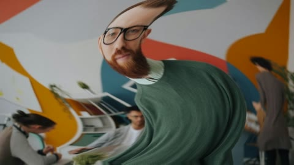</a>
</td><td align="center" width="33%">
<b>Fisheye Pulse</b> Distort - The lens bows outward on a slow pulse, corners darkening with the bow. 
</td></tr>
  <tr><td align="center" width="33%">
<b>Wide Warp</b> Distort - A steady barrel bend, the wide-angle look. 
</td><td align="center" width="33%">
<b>Pincushion</b> Distort - The frame pinched in at the corners - the telephoto opposite. 
</td><td align="center" width="33%">
<b>Earthquake</b> Distort - Two heavy jolts with the brightness slamming each time. 
</td></tr>
  <tr><td align="center" width="33%">
<b>Handheld Sway</b> Distort - The operator's breathing: a slow two-axis drift with exposure to match. 
</td><td align="center" width="33%">
<b>Drone Float</b> Distort - The gimbal's version of still: a glacial drift, exposure barely breathing. 
</td><td align="center" width="33%">
<b>Breathing Zoom</b> Distort - The frame slowly leans in and back out, the Ken Burns heartbeat. 
</td></tr>
  <tr><td align="center" width="33%">
<b>Shake Pulse</b> Distort - A quick jolt on the beat, five to the bar. 
</td><td align="center" width="33%">
<b>Camera Roll Sway</b> Distort - The horizon leans one way and back, a boat-deck roll. 
</td><td align="center" width="33%">
<b>Halation</b> Film - The red-orange halo film lays around its blown highlights, where light passes through the emulsion, scatters off the backing and comes back. 
</td></tr>
  <tr><td align="center" width="33%">
<b>Corona</b> Film - A cool blue-white corona gathered off the picture's blown highlights by a golden-angle spiral blur - built from nothing, not a port of the stock halation. 
</td><td align="center" width="33%">
<b>Cinema Bars</b> Frame & Focus - 2.39:1 scope bars top and bottom, the picture held a touch brighter between. <a href="../src/crates/concat/cards/concat.cinema-bars.jpg">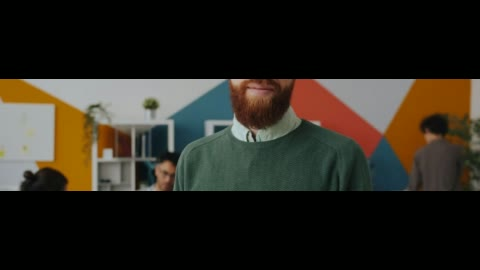</a>
</td><td align="center" width="33%">
<b>Vignette Pulse</b> Frame & Focus - A vignette that breathes with the shot. 
</td></tr>
  <tr><td align="center" width="33%">
<b>Soft Vignette</b> Frame & Focus - A steady, gentle darkening at the corners - the portrait lens. 
</td><td align="center" width="33%">
<b>Split Frame Line</b> Frame & Focus - A thin lit rule down the middle - the split-screen divider. 
</td><td align="center" width="33%">
<b>Film Jitter</b> Frame & Focus - The print chattering in the gate, quick and light. 
</td></tr>
  <tr><td align="center" width="33%">
<b>Camera Sway</b> Frame & Focus - A gentle lean and drift - the operator finding the shot. 
</td><td align="center" width="33%">
<b>Drone Glide</b> Frame & Focus - The long slow drift of a locked-off drone. 
</td><td align="center" width="33%">
<b>Perspective Tilt</b> Frame & Focus - The frame leans back, top narrowing - the scrapbook tilt. 
</td></tr>
  <tr><td align="center" width="33%">
<b>Photo Frame</b> Frame & Focus - A clean border with a soft inner shadow: the print on the table. 
</td><td align="center" width="33%">
<b>Widescreen Glow</b> Frame & Focus - Scope bars and a bloom together - the anamorphic night composite. 
</td><td align="center" width="33%">
<b>Bloom Pulse</b> Light - A soft bloom over the highlights that breathes in and out. 
</td></tr>
  <tr><td align="center" width="33%">
<b>God Rays</b> Light & Glow - Shafts of light from the centre, each at its own strength, breathing slowly. 
</td><td align="center" width="33%">
<b>Sun Flare Sweep</b> Light & Glow - A warm flare rolling in from the corner, the sun crossing the lens. 
</td><td align="center" width="33%">
<b>Bokeh Sparkle</b> Light & Glow - Soft circles of light drifting through the frame, twinkling as they go. 
</td></tr>
  <tr><td align="center" width="33%">
<b>Neon Glow Pulse</b> Light & Glow - The picture's own light laid back over itself as a cool neon glow. 
</td><td align="center" width="33%">
<b>Rim Light</b> Light & Glow - A cool light from above the frame, like a lamp just out of shot. 
</td><td align="center" width="33%">
<b>Anamorphic Streak</b> Light & Glow - A horizontal blue streak on the brights - the night-city lens. 
</td></tr>
  <tr><td align="center" width="33%">
<b>Star Filter</b> Light & Glow - Bright pixels grow a soft four-point cross, the classic star filter. 
</td><td align="center" width="33%">
<b>Glow Bloom</b> Light & Glow - The brights screened back over the picture: a clean one-knob bloom. 
</td><td align="center" width="33%">
<b>Warm Light Leak</b> Light & Glow - An amber leak breathing in from one corner, the film back rolled. 
</td></tr>
  <tr><td align="center" width="33%">
<b>Cool Light Leak</b> Light & Glow - A cyan leak from the top corner - the modern, cold sibling. 
</td><td align="center" width="33%">
<b>Prism Rainbow</b> Light & Glow - A rainbow wash sliding across the brights, as if a prism hung on the lens. 
</td><td align="center" width="33%">
<b>Spotlight Pool</b> Light & Glow - A hard pool of light in the middle of the frame; the rest falls away. 
</td></tr>
  <tr><td align="center" width="33%">
<b>Snow Fall</b> Particles - A steady snowfall of soft white flakes drifting down. 
</td><td align="center" width="33%">
<b>Embers Rise</b> Particles - Warm embers floating up, flickering as they climb. 
</td><td align="center" width="33%">
<b>Sparkle Glitter</b> Particles - A dust of twinkling glitter, brightest against the dark. 
</td></tr>
  <tr><td align="center" width="33%">
<b>Confetti</b> Particles - Confetti in three colours, tumbling down the frame. 
</td><td align="center" width="33%">
<b>Fireflies</b> Particles - Green-yellow points wandering and blinking, a summer dusk. 
</td><td align="center" width="33%">
<b>Dust Motes</b> Particles - Slow grey specks in a shaft of light. 
</td></tr>
  <tr><td align="center" width="33%">
<b>Rain Streaks</b> Particles - Thin fast streaks of rain, read as motion rather than droplets. 
</td><td align="center" width="33%">
<b>Neon Rain</b> Particles - Cyan rain over the night read - the street-lit downpour. 
</td><td align="center" width="33%">
<b>Rolling Fog</b> Particles - Big soft cells of grey drifting over the picture. 
</td></tr>
  <tr><td align="center" width="33%">
<b>Cloud Drift</b> Particles - Bright soft cells rolling by, a fair-weather wash. 
</td><td align="center" width="33%">
<b>Lightning Flash</b> Particles - A double-strobe of light every couple of seconds, each strike its own strength. 
</td><td align="center" width="33%">
<b>Starfield Warp</b> Particles - Points of light streaking down the frame, the hyperspace read. 
</td></tr>
  <tr><td align="center" width="33%">
<b>Bubbles</b> Particles - Soft round bubbles drifting up through the frame. 
</td><td align="center" width="33%">
<b>Magic Sparkle</b> Particles - Violet sparks that twinkle and wander - the spell read. 
</td><td align="center" width="33%">
<b>Fire Flicker</b> Particles - Warm uneven light rolling across the frame, firelight without the fire. 
</td></tr>
  <tr><td align="center" width="33%">
<b>Matrix Drizzle</b> Particles - Green glyphs raining down, fast and cold. 
</td><td align="center" width="33%">
<b>Halftone</b> Retro - The picture reduced to a grid of black and white dots. <a href="../src/crates/concat/cards/concat.halftone.jpg">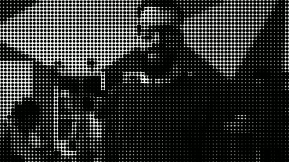</a>
</td><td align="center" width="33%">
<b>VHS Lines</b> Retro & Tape - Tape lines, a wandering bright band and a whisper of colour skew. 
</td></tr>
  <tr><td align="center" width="33%">
<b>Scanlines</b> Retro & Tape - The CRT raster: fine dark lines down the frame. 
</td><td align="center" width="33%">
<b>CRT Triad</b> Retro & Tape - A colour tube's rgb stripes, merging to white at a distance. 
</td><td align="center" width="33%">
<b>Tape Tracking</b> Retro & Tape - A bright band wanders down the frame dragging noise with it. 
</td></tr>
  <tr><td align="center" width="33%">
<b>Projector Flicker</b> Retro & Tape - Carbon-arc flicker, brightest in the middle of the gate. 
</td><td align="center" width="33%">
<b>Gate Weave</b> Retro & Tape - The frame drifts a hair and breathes, the projector gate never quite still. 
</td><td align="center" width="33%">
<b>Film Scratch</b> Retro & Tape - Hair-thin scratches that come and go, running up the frame. 
</td></tr>
  <tr><td align="center" width="33%">
<b>Print Halftone</b> Retro & Tape - Luma turned to a field of dots, light on dark - the print read. 
</td><td align="center" width="33%">
<b>Newspaper</b> Retro & Tape - Cheap print: grey, grainy, a coarse dot screen and no colour worth the name. 
</td><td align="center" width="33%">
<b>Dot Matrix</b> Retro & Tape - A coarse dot grid over the picture, the receipt-printer read. 
</td></tr>
  <tr><td align="center" width="33%">
<b>Speed Lines</b> Speed & Motion - Radial speed lines over the picture - the anime 'going fast' read. 
</td><td align="center" width="33%">
<b>Speed Lines Cyan</b> Speed & Motion - Cool cyan speed lines, the synthwave sibling. 
</td><td align="center" width="33%">
<b>Radial Speed Blur</b> Speed & Motion - A radial smear flying out from the centre with a hot middle. 
</td></tr>
  <tr><td align="center" width="33%">
<b>Zoom Blur Punch</b> Speed & Motion - The punch-zoom's blur: centre bright, edges streaked outward. 
</td><td align="center" width="33%">
<b>Motion Echo</b> Speed & Motion - Ghost copies of the frame stacked behind itself. <a href="../src/crates/concat/cards/concat.motion-echo.jpg">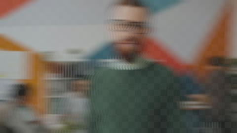</a>
</td><td align="center" width="33%">
<b>Ghost Trail</b> Speed & Motion - A longer, softer echo - four ghosts deep. 
</td></tr>
  <tr><td align="center" width="33%">
<b>Frame Stutter</b> Speed & Motion - Time holds still in steps, a flash on each advance - the stutter edit. 
</td><td align="center" width="33%">
<b>Beat Pulse</b> Speed & Motion - Brightness that lands on a 120 bpm beat, the edit's own metronome. 
</td><td align="center" width="33%">
<b>Directional Blur Left</b> Speed & Motion - A horizontal smear to the left with the brightness leaning with it. 
</td></tr>
  <tr><td align="center" width="33%">
<b>Directional Blur Right</b> Speed & Motion - A horizontal smear to the right, brightness leaning east. 
</td><td align="center" width="33%">
<b>Directional Blur Up</b> Speed & Motion - A vertical smear upwards - the rising read. 
</td><td align="center" width="33%">
<b>Directional Blur Down</b> Speed & Motion - A vertical smear downwards - the weight and the fall. 
</td></tr>
  <tr><td align="center" width="33%">
<b>Vignette</b> Stylize - Darkened corners that draw the eye to the middle. 
</td><td align="center" width="33%">
<b>Film Grain</b> Stylize - Dancing grain, the texture of film stock. 
</td><td align="center" width="33%">
<b>Glow</b> Stylize - A soft bloom around the bright parts of the picture. 
</td></tr>
  <tr><td align="center" width="33%">
<b>Posterize</b> Stylize - Flat bands of colour, like a screen print. <a href="../src/crates/concat/cards/concat.posterize.jpg">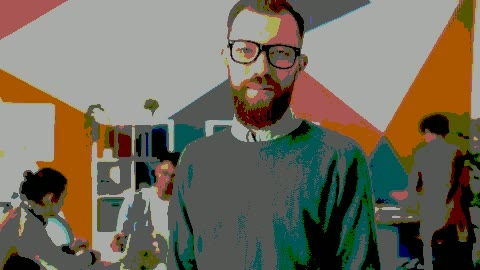</a>
</td><td align="center" width="33%">
<b>Anime Speed Focus</b> Stylize - Warm speed lines focused hard on the middle - the anime rush at sunset. 
</td><td align="center" width="33%">
<b>Manga Impact</b> Stylize - Impact-frame manga: hard radial lines and a dot screen, no half measures. 
</td></tr>
  <tr><td align="center" width="33%">
<b>Comic Halftone</b> Stylize - The comic panel: bold dots carrying the luma, ink and paper. 
</td><td align="center" width="33%">
<b>Sketch Paper</b> Stylize - The pencil read: edges drawn, everything else paper and grain. 
</td><td align="center" width="33%">
<b>Crosshatch</b> Stylize - Diagonal hatching whose density follows the shadows - the engraver's read. 
</td></tr>
  <tr><td align="center" width="33%">
<b>Blueprint</b> Stylize - Cyan paper, white grid, the picture ghosted into the lines. <a href="../src/crates/concat/cards/concat.blueprint.jpg">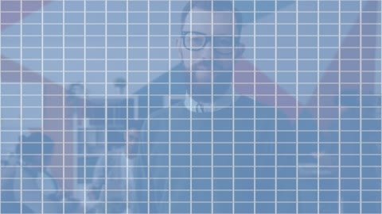</a>
</td><td align="center" width="33%">
<b>Neon Outline</b> Stylize - A neon lift on the brights with the saturation pushed - the outline glow. 
</td><td align="center" width="33%">
<b>Pixel Mosaic</b> Stylize - Big honest pixels with a whisper of grid so they read as pixels. <a href="../src/crates/concat/cards/concat.pixel-mosaic.jpg">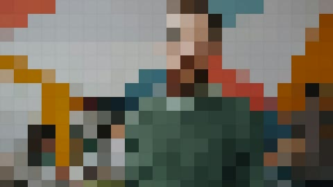</a>
</td></tr>
  <tr><td align="center" width="33%">
<b>Glitch Blocks</b> Stylize - Random blocks jump sideways and the channels shear apart - always somewhere new. 
</td><td align="center" width="33%">
<b>Databend Smear</b> Stylize - Heavy horizontal smear bands, the codec misbehaving on purpose. 
</td><td align="center" width="33%">
<b>Toon Shade</b> Stylize - Cel shading: flat steps of colour, saturation up, nothing between. 
</td></tr>
  <tr><td align="center" width="33%">
<b>Gradient Duo</b> Stylize - Two colours sliding across the frame by luma - the music-video gradient. 
</td><td align="center" width="33%">
<b>Bloom Haze</b> Stylize - A heavy bloom with a lift through the mids - the dream composite. 
</td><td align="center" width="33%">
<b>Colour Bleed</b> Stylize - The channels smear slowly apart, analogue colour on the run. 
</td></tr>
</table>

## Transitions (122)

The cut halfway through, from the plate to a mirrored, hue-turned copy of it.

<table>
  <tr><td align="center" width="33%">
<b>Dissolve</b> Basic - A soft cross-dissolve from one shot into the next. 
</td><td align="center" width="33%">
<b>Fade to Black</b> Basic - The outgoing shot fades down to black, then the incoming one fades up out of it. 
</td><td align="center" width="33%">
<b>Fade to White</b> Basic - The outgoing shot fades up to white, then the incoming one fades down out of it. 
</td></tr>
  <tr><td align="center" width="33%">
<b>Film Burn Ember</b> Cinematic - The frame heats through the cut: ember glow flickering up and a hot white core at the swap. 
</td><td align="center" width="33%">
<b>Letterbox Slam</b> Cinematic - Cinema bars slam in, the cut lands behind them, and they lift off the new shot. 
</td><td align="center" width="33%">
<b>Shuttle Warp</b> Cinematic - Radial speed lines burst from the centre as the cut lands - the warp-jump read. 
</td></tr>
  <tr><td align="center" width="33%">
<b>Neon Streak</b> Cinematic - Cyan-magenta speed lines shear past the cut, the synthwave shuttle. 
</td><td align="center" width="33%">
<b>Gravity Drop</b> Cinematic - The new shot falls in from above with weight and settles hard. <a href="../src/crates/concat/cards/concat.gravity-drop.jpg">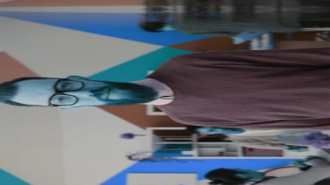</a>
</td><td align="center" width="33%">
<b>Magnet Pull</b> Cinematic - The new shot is pulled onto the screen from tiny, snapping in like it was magnetised. <a href="../src/crates/concat/cards/concat.magnet-pull.jpg">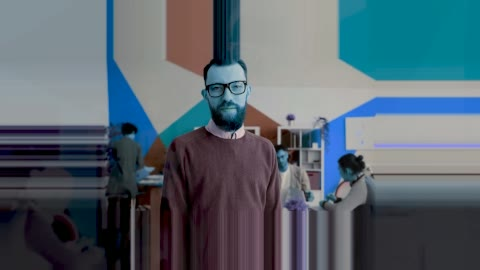</a>
</td></tr>
  <tr><td align="center" width="33%">
<b>Hyperlapse Blur</b> Cinematic - The shot breathes wide and rushes back in - the hyperlapse breath between two places. 
</td><td align="center" width="33%">
<b>Anamorphic Squeeze</b> Cinematic - The frame squeezes horizontally through the cut, the anamorphic lens change. 
</td><td align="center" width="33%">
<b>Dream Dissolve</b> Cinematic - A soft warm bloom bridges the two shots, half-remembered and gentle. 
</td></tr>
  <tr><td align="center" width="33%">
<b>Storm Fade</b> Cinematic - The shot dims and cools as if a cloud crossed the sun, and clears on the new one. 
</td><td align="center" width="33%">
<b>Blur Dissolve</b> Dissolve - A cross-dissolve that blurs into the cut and sharpens back out of it. 
</td><td align="center" width="33%">
<b>Film Burn</b> Dissolve - A warm over-exposed flash burns through the cut. 
</td></tr>
  <tr><td align="center" width="33%">
<b>Impact Flash</b> Flash & Impact - A white shockwave of light right on the cut - the hit that lands with the beat. 
</td><td align="center" width="33%">
<b>Blackout Cut</b> Flash & Impact - The world dips to black for a breath and comes back as the new shot. 
</td><td align="center" width="33%">
<b>Whiteout Cut</b> Flash & Impact - A clean blowout to white and back - the softest hard cut there is. 
</td></tr>
  <tr><td align="center" width="33%">
<b>Invert Flash</b> Flash & Impact - The negative flashes through the cut: one frame of anti-matter between two shots. 
</td><td align="center" width="33%">
<b>Bloom Punch</b> Flash & Impact - Exposure punches up into bloom at the cut and settles on the new shot. 
</td><td align="center" width="33%">
<b>Exposure Slam</b> Flash & Impact - A hard exposure ramp that slams the new shot in bright and falls back to level. 
</td></tr>
  <tr><td align="center" width="33%">
<b>Light Blast</b> Flash & Impact - Warm light floods the sensor at the cut, a lens pointed at the sun for one beat. 
</td><td align="center" width="33%">
<b>Chroma Pop</b> Flash & Impact - Saturation spikes through the cut - the new shot arrives louder than life. 
</td><td align="center" width="33%">
<b>Strobe Beat</b> Flash & Impact - Three fast strobes across the cut instead of one long flash - the nightclub edit. 
</td></tr>
  <tr><td align="center" width="33%">
<b>Strobe Dark</b> Flash & Impact - Three blackouts strobing across the cut - the darker sibling of the beat strobe. 
</td><td align="center" width="33%">
<b>Glitch</b> Glitch - Digital tearing and channel splitting rip through the cut. <a href="../src/crates/concat/cards/concat.glitch-transition.jpg">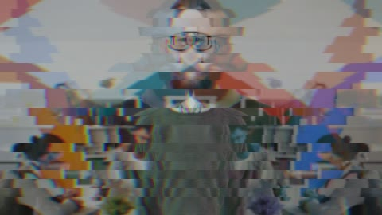</a>
</td><td align="center" width="33%">
<b>RGB Split</b> Glitch - The colour channels pull apart through the cut and snap back together. 
</td></tr>
  <tr><td align="center" width="33%">
<b>Glitch Warp</b> Glitch - Chromatic slice tear and digital pixel displacement transition. <a href="../src/crates/concat/cards/concat.glitch-warp.jpg">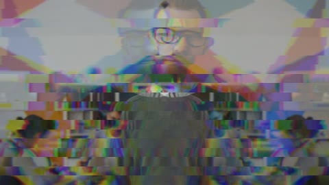</a>
</td><td align="center" width="33%">
<b>Datamosh Warp</b> Glitch - The picture tears into smeared slices and reassembles as the new shot - the datamosh look without the codec. <a href="../src/crates/concat/cards/concat.datamosh-warp.jpg">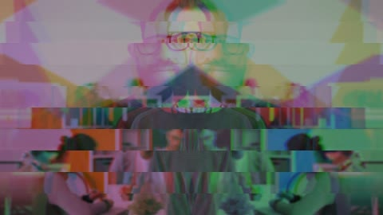</a>
</td><td align="center" width="33%">
<b>Signal Drop</b> Glitch - The broadcast loses sync: bands jump, colour smears, and the new shot tunes in. 
</td></tr>
  <tr><td align="center" width="33%">
<b>Track Jump</b> Glitch - The tape jumps its track in three thick bands - a VHS crash cut for retro segments. 
</td><td align="center" width="33%">
<b>Compression Smear</b> Glitch - Sixteen rows of blocky smear, as if the bitstream gave up exactly at the cut. <a href="../src/crates/concat/cards/concat.compression-smear.jpg">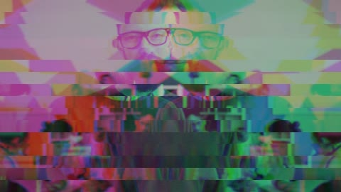</a>
</td><td align="center" width="33%">
<b>Bitrate Crash</b> Glitch - Fine tearing, heavy scan darkening and channel split: the stream falling apart in real time. <a href="../src/crates/concat/cards/concat.bitrate-crash.jpg">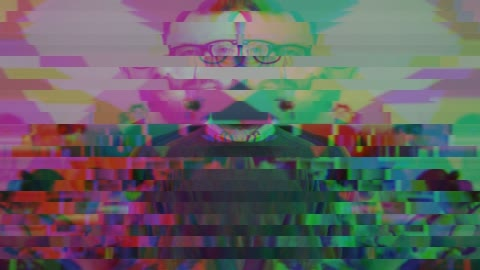</a>
</td></tr>
  <tr><td align="center" width="33%">
<b>Tear Streak</b> Glitch - Eight bands tear sideways with a bright chroma streak along each seam. <a href="../src/crates/concat/cards/concat.tear-streak.jpg">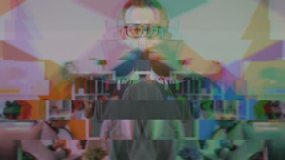</a>
</td><td align="center" width="33%">
<b>Pixel Storm</b> Glitch - A fine grid of cells flips to the new shot in a hashed storm - dissolve energy with glitch texture. 
</td><td align="center" width="33%">
<b>Block Shuffle</b> Glitch - Big blocks shuffle over in a random order, the sliding-puzzle cut. 
</td></tr>
  <tr><td align="center" width="33%">
<b>Tile Stagger</b> Glitch - Six rows of tiles turn over one after another, each a little later than the last. 
</td><td align="center" width="33%">
<b>Static Burst</b> Glitch - A wall of noise-static swallows the cut and clears to reveal the next shot. 
</td><td align="center" width="33%">
<b>Light Leak</b> Light - A warm streak of light sweeps across the cut. 
</td></tr>
  <tr><td align="center" width="33%">
<b>Cube</b> Light - The outgoing shot rotates away like a cube face as the incoming one rotates into view. 
</td><td align="center" width="33%">
<b>Light Leak Flash</b> Light - Organic overexposed film burn flash bridging the cut. 
</td><td align="center" width="33%">
<b>Meme Shake</b> Meme & Bounce - A zoom pulse with a camera jolt and brightness flicker - the meme-zoom cut. 
</td></tr>
  <tr><td align="center" width="33%">
<b>Rumble Cut</b> Meme & Bounce - A low heavy jolt: two slow shake pulses and the swap lands between them. 
</td><td align="center" width="33%">
<b>Bounce Drop</b> Meme & Bounce - The new shot drops in from above and bounces to rest. <a href="../src/crates/concat/cards/concat.bounce-drop.jpg">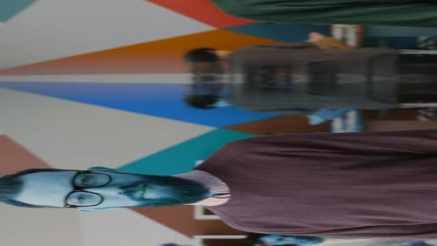</a>
</td><td align="center" width="33%">
<b>Elastic Snap</b> Meme & Bounce - The new shot snaps in from the side and rings to a stop like a rubber band. 
</td></tr>
  <tr><td align="center" width="33%">
<b>Rubber Band</b> Meme & Bounce - A push that stretches past its mark and springs back, both ways at once. 
</td><td align="center" width="33%">
<b>Jelly Wobble</b> Meme & Bounce - The new shot lands with a wobble like set jelly, the seam jiggling as it settles. 
</td><td align="center" width="33%">
<b>Squash Cut</b> Meme & Bounce - The picture squashes to a slit, swaps, and stretches back - cartoon squash and stretch. 
</td></tr>
  <tr><td align="center" width="33%">
<b>Pop In Scale</b> Meme & Bounce - The new shot arrives large and elastic, popping down into place. 
</td><td align="center" width="33%">
<b>Ink Bleed</b> Organic - The new shot bleeds through the old like ink through paper, ragged and soft. 
</td><td align="center" width="33%">
<b>Smoke Reveal</b> Organic - Smoke clears off the new shot, soft-edged and drifting. 
</td></tr>
  <tr><td align="center" width="33%">
<b>Dust Melt</b> Organic - A fine dust of cells drifts the old shot away, one speck at a time. 
</td><td align="center" width="33%">
<b>Ripple Dissolve</b> Organic - Rings of the new shot spread through the old, like a stone dropped in a pond. 
</td><td align="center" width="33%">
<b>Wave Warp</b> Organic - A tide of a boundary sweeps up the frame with a swell along its length. <a href="../src/crates/concat/cards/concat.wave-warp.jpg">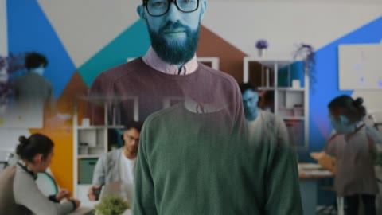</a>
</td></tr>
  <tr><td align="center" width="33%">
<b>Kaleido Morph</b> Organic - Six mirrored sectors fold through the cut, each turning over at its own moment. 
</td><td align="center" width="33%">
<b>Liquid Melt</b> Organic - The old shot sags and runs down the frame, the new one showing through where it thins. 
</td><td align="center" width="33%">
<b>Ember Dissolve</b> Organic - A fine grid of embers eats the old shot away, warm at the edges of each cell. 
</td></tr>
  <tr><td align="center" width="33%">
<b>Circle Pop</b> Shape Reveal - A circle springs open with elastic overshoot and a white rim - the classic pop reveal. 
</td><td align="center" width="33%">
<b>Diamond Swing</b> Shape Reveal - A diamond sweeps open with a backward snap and a cool edge. 
</td><td align="center" width="33%">
<b>Star Wipe Spin</b> Shape Reveal - A five-point star spins open from the centre - loud, proud, and unapologetic. 
</td></tr>
  <tr><td align="center" width="33%">
<b>Heart Open</b> Shape Reveal - A heart blooms open with a soft pink rim. Weddings, romance montages, and comment-bait. 
</td><td align="center" width="33%">
<b>Hex Reveal</b> Shape Reveal - A hexagon opens with a cyan rim - the tech-channel staple. <a href="../src/crates/concat/cards/concat.hex-reveal.jpg">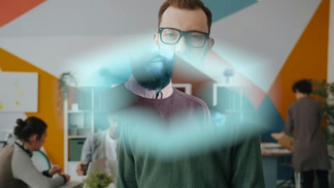</a>
</td><td align="center" width="33%">
<b>Triangle Rise</b> Shape Reveal - A hard triangle punches up from below with an expo snap. 
</td></tr>
  <tr><td align="center" width="33%">
<b>Box Pop</b> Shape Reveal - A rounded square springs open with elastic overshoot, the UI-card reveal. 
</td><td align="center" width="33%">
<b>Burst Star</b> Shape Reveal - An eight-point star bursts open with a hot gold rim - the impact-frame reveal. 
</td><td align="center" width="33%">
<b>Cross Pop</b> Shape Reveal - A cross springs open - the church-cut, and the comic impact flash besides. 
</td></tr>
  <tr><td align="center" width="33%">
<b>Soft Iris</b> Shape Reveal - A wide soft-edged circle fades the new shot in - the old-school iris, gentle. 
</td><td align="center" width="33%">
<b>Venetian Down</b> Slice & Split - Nine horizontal slats close top to bottom and open on the new shot. 
</td><td align="center" width="33%">
<b>Venetian Across</b> Slice & Split - Vertical slats sweep across, left to right, row by row. 
</td></tr>
  <tr><td align="center" width="33%">
<b>Checker Sweep</b> Slice & Split - Every other band flips direction: a checkerboard flood of the new shot. 
</td><td align="center" width="33%">
<b>Soft Blinds</b> Slice & Split - Five wide, softly feathered bands - a calm, editorial stagger. 
</td><td align="center" width="33%">
<b>Bars Collapse</b> Slice & Split - Six columns collapse downward one after another, the scaffold coming down. 
</td></tr>
  <tr><td align="center" width="33%">
<b>Curtain Lift</b> Slice & Split - The old shot lifts away like a theatre curtain and the new one was on stage all along. 
</td><td align="center" width="33%">
<b>Razor Diagonal</b> Slice & Split - A hard diagonal razor line cuts corner to corner with a lit edge. 
</td><td align="center" width="33%">
<b>Blade Flash</b> Slice & Split - A bright blade sweeps from the bottom-right corner, hot edge first. <a href="../src/crates/concat/cards/concat.blade-flash.jpg">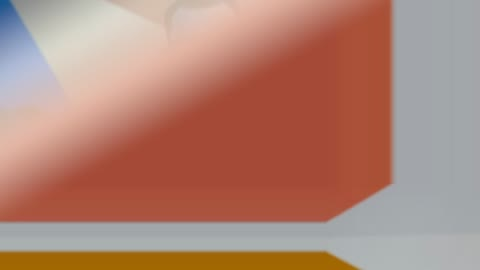</a>
</td></tr>
  <tr><td align="center" width="33%">
<b>Double Blade</b> Slice & Split - Top and bottom halves sweep in from the edges and meet in the middle. 
</td><td align="center" width="33%">
<b>Band Tease</b> Slice & Split - Three bands flip in alternating directions, teasing the shot in thirds. 
</td><td align="center" width="33%">
<b>Slide</b> Slide - The incoming shot slides in over the outgoing one, which holds still underneath. 
</td></tr>
  <tr><td align="center" width="33%">
<b>Push</b> Slide - The incoming shot pushes the outgoing one off the frame. 
</td><td align="center" width="33%">
<b>Story Slide</b> Social FX - The clean vertical slide every story edit uses, with a soft seam and a gentle dim. 
</td><td align="center" width="33%">
<b>Soft Swipe</b> Social FX - A lateral swipe with a wide feather and a whisper of edge light. 
</td></tr>
  <tr><td align="center" width="33%">
<b>Hard Swipe</b> Social FX - A crisp swipe with a bright edge line - the infographic cut. 
</td><td align="center" width="33%">
<b>Zoom Slam</b> Social FX - A fast zoom with a white hit at the swap - the retention edit's best friend. 
</td><td align="center" width="33%">
<b>Spin Social</b> Social FX - A quick half-spin with a zoom pulse and the swap at the fastest moment. <a href="../src/crates/concat/cards/concat.spin-social.jpg">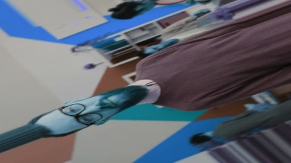</a>
</td></tr>
  <tr><td align="center" width="33%">
<b>Slice Social</b> Social FX - Four clean bands slice the new shot in, one after another. 
</td><td align="center" width="33%">
<b>Flash Social</b> Social FX - A bright single flash right on the beat, over before it registers. 
</td><td align="center" width="33%">
<b>Glitch Social</b> Social FX - A light three-band glitch with a chroma streak - digital, quick, loud. 
</td></tr>
  <tr><td align="center" width="33%">
<b>Spin</b> Spin - The outgoing shot spins away as the incoming one spins into place. <a href="../src/crates/concat/cards/concat.spin.jpg">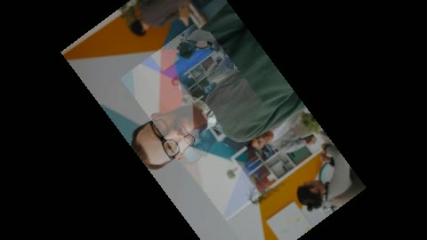</a>
</td><td align="center" width="33%">
<b>Swirl</b> Spin - The cut twists both pictures around its centre and untwists into the next shot. <a href="../src/crates/concat/cards/concat.swirl.jpg">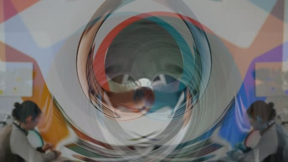</a>
</td><td align="center" width="33%">
<b>Door Swing</b> Spin & Flip - The outgoing shot swings away on a hinge at its edge, lit like a door in a doorway. 
</td></tr>
  <tr><td align="center" width="33%">
<b>Flip Card</b> Spin & Flip - The picture flips over like a trading card and the new shot is on the back. 
</td><td align="center" width="33%">
<b>Flip Snap</b> Spin & Flip - An expo-fast card flip: there, edge-on, and the new face lands. 
</td><td align="center" width="33%">
<b>Spin Toss</b> Spin & Flip - The shot spins a full turn through the cut, the new one arriving mid-rotation. 
</td></tr>
  <tr><td align="center" width="33%">
<b>Barrel Roll</b> Spin & Flip - A full barrel roll with a zoom pulse - do a barrel roll. 
</td><td align="center" width="33%">
<b>Swivel Tilt</b> Spin & Flip - A quarter-turn swivel with the switch early, so the new shot settles the spin. <a href="../src/crates/concat/cards/concat.swivel-tilt.jpg">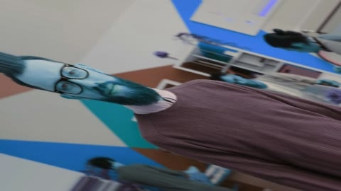</a>
</td><td align="center" width="33%">
<b>Portal Spin</b> Spin & Flip - A double rotation through a zoom - stepping through a spinning door between shots. 
</td></tr>
  <tr><td align="center" width="33%">
<b>Twirl Cut</b> Spin & Flip - A tight overshooting twirl, the new shot catching the picture as it settles. <a href="../src/crates/concat/cards/concat.twirl-cut.jpg">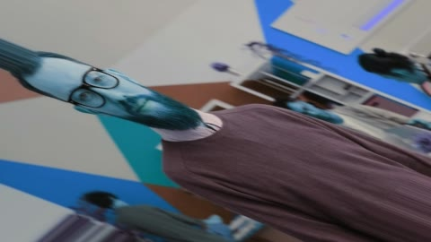</a>
</td><td align="center" width="33%">
<b>Punch In</b> Viral Zoom - The outgoing shot snaps away and the incoming one lands already zooming, a beat-drop of scale. 
</td><td align="center" width="33%">
<b>Punch Out</b> Viral Zoom - The cut zooms out of the old shot and the new one arrives small and grows to meet the eye. <a href="../src/crates/concat/cards/concat.punch-out.jpg">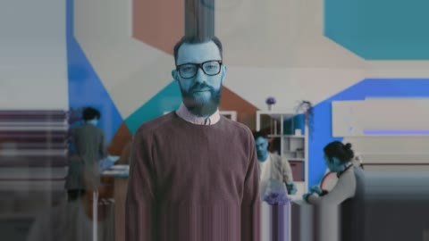</a>
</td></tr>
  <tr><td align="center" width="33%">
<b>Crash Zoom</b> Viral Zoom - Both pictures slam through each other at once - the documentary crash zoom, hard and fast. 
</td><td align="center" width="33%">
<b>Snap Zoom</b> Viral Zoom - A fifth-power zoom that barely moves until it doesn't: nothing, nothing, snap. <a href="../src/crates/concat/cards/concat.snap-zoom.jpg">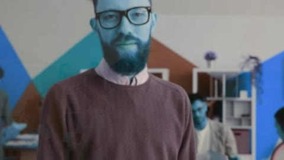</a>
</td><td align="center" width="33%">
<b>Dolly Vertigo</b> Viral Zoom - The outgoing shot pushes in while its scale pulls back - the Hitchcock pull, uneasy and pulling the eye. 
</td></tr>
  <tr><td align="center" width="33%">
<b>Zoom Roll</b> Viral Zoom - A zoom with the camera corkscrewing through the cut - energy enough for a montage beat. 
</td><td align="center" width="33%">
<b>Hyper Zoom</b> Viral Zoom - An exponential runaway zoom with a white spark at the cut - the hype-edit staple. 
</td><td align="center" width="33%">
<b>Velocity Ramp</b> Viral Zoom - The zoom accelerates like a speed ramp: slow, then gone. Made for sport and car edits. 
</td></tr>
  <tr><td align="center" width="33%">
<b>Heartbeat Zoom</b> Viral Zoom - The scale beats twice through the cut, a pulse you can cut music to. 
</td><td align="center" width="33%">
<b>Portal Zoom</b> Viral Zoom - A zoom that warms to amber as it goes, as if the new shot were lit from somewhere else. 
</td><td align="center" width="33%">
<b>Whip Left</b> Whip & Pan - The camera whips left so fast the shot smears, and the new one is there when the eye lands. 
</td></tr>
  <tr><td align="center" width="33%">
<b>Whip Right</b> Whip & Pan - The camera whips right so fast the shot smears, and the new one is there when the eye lands. 
</td><td align="center" width="33%">
<b>Whip Up</b> Whip & Pan - The camera whips up so fast the shot smears, and the new one is there when the eye lands. <a href="../src/crates/concat/cards/concat.whip-up.jpg">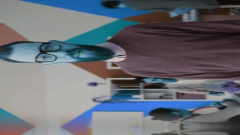</a>
</td><td align="center" width="33%">
<b>Whip Down</b> Whip & Pan - The camera whips down so fast the shot smears, and the new one is there when the eye lands. <a href="../src/crates/concat/cards/concat.whip-down.jpg">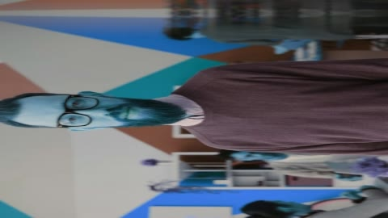</a>
</td></tr>
  <tr><td align="center" width="33%">
<b>Lurch Whip</b> Whip & Pan - A whip that overshoots and lurches back - the drunk-camera cut for comedy and shock beats. <a href="../src/crates/concat/cards/concat.lurch-whip.jpg">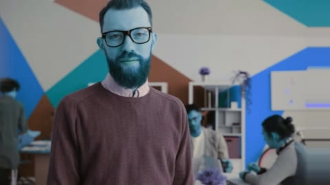</a>
</td><td align="center" width="33%">
<b>Pendulum Swipe</b> Whip & Pan - The new shot swings in past the middle and settles back like a pendulum finding rest. <a href="../src/crates/concat/cards/concat.pendulum-swipe.jpg">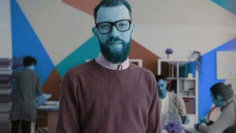</a>
</td><td align="center" width="33%">
<b>Conveyor Push</b> Whip & Pan - Both shots ride the same belt: one leaves exactly as fast as the other arrives. 
</td></tr>
  <tr><td align="center" width="33%">
<b>Trap Reveal</b> Whip & Pan - The old shot springs away and the new one was under it all along, snapped in place like a trap. 
</td><td align="center" width="33%">
<b>Linear Wipe</b> Wipe - A straight edge wipes the incoming shot across the outgoing one. 
</td><td align="center" width="33%">
<b>Iris</b> Wipe - A circle opens from the centre to reveal the incoming shot. 
</td></tr>
  <tr><td align="center" width="33%">
<b>Shape Wipe</b> Wipe - The incoming shot grows through a shape from the centre of the cut. <a href="../src/crates/concat/cards/concat.shape-wipe.jpg">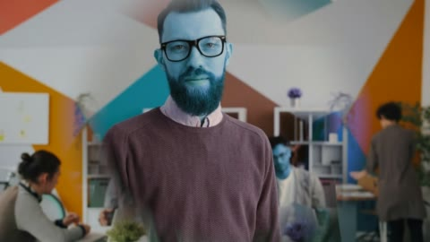</a>
</td><td align="center" width="33%">
<b>Whip Pan</b> Wipe - High-speed directional camera whip with motion blur. 
</td><td align="center" width="33%">
<b>Clock Wipe</b> Wipe - A hand sweeps around the centre, revealing the incoming shot as it turns. <a href="../src/crates/concat/cards/concat.clock-wipe.jpg">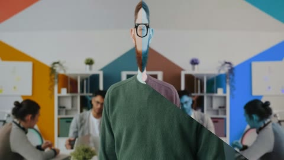</a>
</td></tr>
  <tr><td align="center" width="33%">
<b>Zoom</b> Zoom - A whip zoom out of the outgoing shot and into the incoming one. 
</td><td align="center" width="33%">
<b>Zoom Blur</b> Zoom - Rapid inward/outward camera rush with radial zoom blur. <a href="../src/crates/concat/cards/concat.zoom-blur-transition.jpg">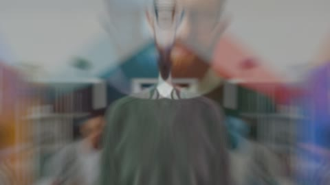</a>
</td><td></td></tr>
</table>

## The audio packages

The 25 audio packages are not pictures and have no cards: their
knobs and what they do are listed in the Audio shelf in the app,
and their FFmpeg chains are their packages' own files.

---

Regenerate this page after bundling cards:
`python3 scripts/effect-gallery.py`.
